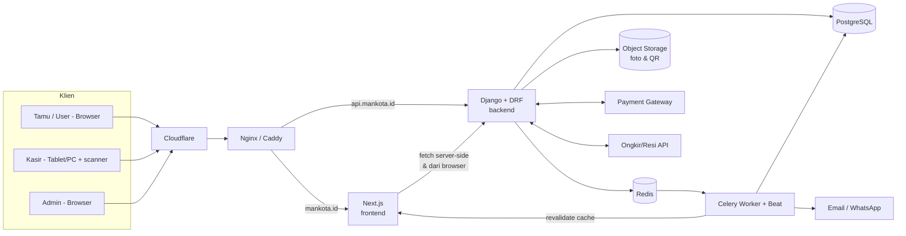
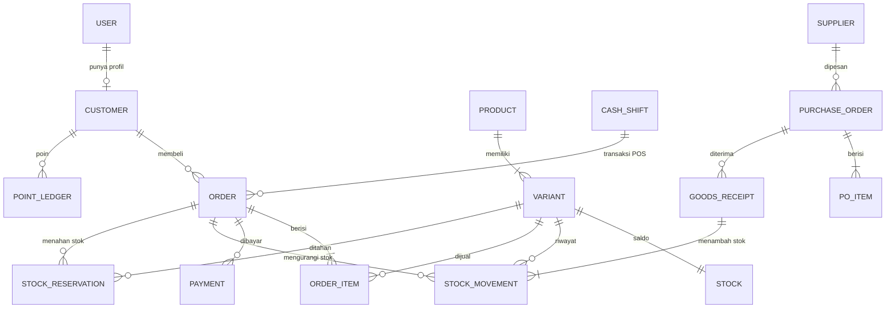
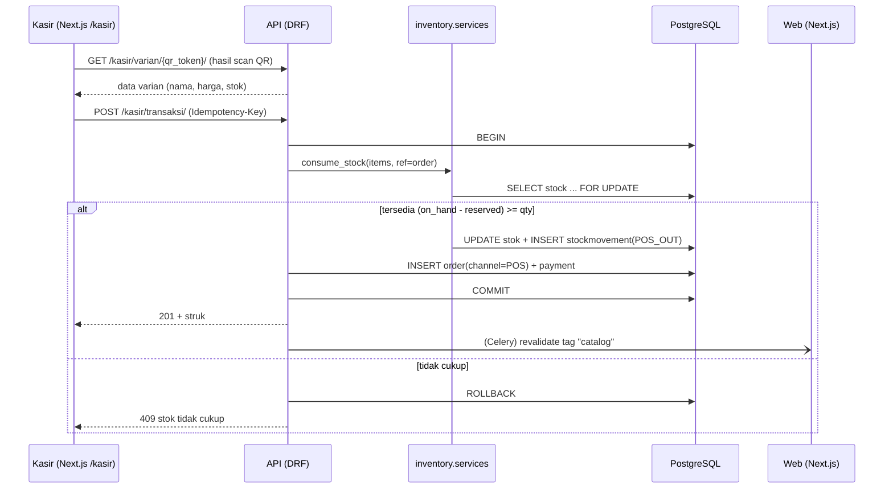

# Arsitektur — Sistem Toko Batik Mankota

Versi: 1.1 (rencana B: backend dan frontend terpisah) · Pendamping `docs/PRD.md`

---

## 1. Prinsip Arsitektur

1. **Dua aplikasi, satu kontrak.** Backend (API) dan frontend dibangun dan di-deploy terpisah, berkomunikasi hanya lewat REST API yang terdokumentasi (OpenAPI).
2. **Backend = satu-satunya sumber kebenaran.** Aturan bisnis, stok, uang, dan izin ada di backend. Frontend hanya menampilkan dan mengirim data; tidak pernah dipercaya untuk keamanan.
3. **Satu sumber kebenaran stok.** POS dan e-commerce memakai layanan inventory yang sama di satu database. Tidak ada "sinkronisasi antar sistem".
4. **Ledger append-only.** Stok dan keuangan dicatat sebagai entri yang tidak diubah; saldo adalah hasil turunan.
5. **Idempoten dan atomik.** Operasi uang dan stok dalam transaksi database dengan kunci idempotensi.
6. **Monolit modular di backend.** Satu aplikasi Django, satu database, banyak modul. Bukan microservices.

---

## 2. Pilihan Teknologi

### Backend (`backend/`)

| Lapisan | Pilihan | Alasan |
|---|---|---|
| Bahasa & framework | **Python 3.12 + Django 5** | ORM, auth, migrasi, sesi |
| API | **Django REST Framework (DRF)** | Serializer, permission, throttling, pagination |
| Dokumentasi API | **drf-spectacular** (OpenAPI 3) | Skema dipakai frontend untuk generate tipe TypeScript |
| Auth | **Sesi Django + CSRF** (cookie `sessionid` HttpOnly) | Tanpa token di JavaScript; aman dari pencurian token lewat XSS |
| Hash password | Argon2 (`argon2-cffi`) | Kuat terhadap brute force |
| Anti brute force | Throttle DRF + lockout berbasis cache (Redis) | Batasi percobaan login/2FA per IP dan kunci akun setelah gagal berulang |
| 2FA admin | TOTP sendiri (`apps/accounts/totp.py`) | Lindungi akun paling berkuasa tanpa dependensi tambahan |
| CORS | `django-cors-headers` | Hanya origin frontend |
| Database | **PostgreSQL 16** | Transaksi, `SELECT … FOR UPDATE`, constraint |
| Tugas latar | **Celery + Redis** | Kadaluarsa reservasi, email, laporan, revalidasi cache frontend |
| Cache / throttle | Redis | Rate limit, cache |
| QR code | `qrcode` + `Pillow` | Generate SVG/PNG |
| Laporan | `openpyxl` (Excel), `WeasyPrint` (PDF) | Ekspor |
| Pengujian | `pytest-django`, `factory_boy` | Alur stok dan izin wajib teruji |

### Frontend (`frontend/`)

| Lapisan | Pilihan | Alasan |
|---|---|---|
| Framework | **Next.js 15 (App Router) + TypeScript** | SSR/ISR untuk SEO landing & katalog, routing, optimasi gambar |
| UI | **React 19** | Komponen dipakai ulang |
| Styling | **Tailwind CSS** | Responsif cepat |
| Komponen | **shadcn/ui** (Radix) | Tabel, dialog, form untuk dashboard dan kasir |
| Data fetching | Server Components (halaman publik) + **TanStack Query** (interaksi dinamis) | Cache dan revalidasi rapi |
| Form & validasi | React Hook Form + **Zod** | Validasi sisi klien (server tetap memvalidasi) |
| Klien API | Tipe dari `openapi-typescript` (generate dari skema backend) | Tipe selalu sinkron dengan API |
| Scan QR | `html5-qrcode` / `@yudiel/react-qr-scanner` + scanner USB (mode keyboard) | Jalan di browser |
| Grafik | Recharts | Dashboard laporan |
| Pengujian | Vitest + React Testing Library, **Playwright** (alur kasir & checkout) | Alur kritis end-to-end |

### Infrastruktur

| Kebutuhan | Pilihan |
|---|---|
| Kontainer | Docker Compose (backend, frontend, worker, beat, db, redis, proxy) |
| Reverse proxy | Nginx atau Caddy (HTTPS otomatis) |
| Edge | Cloudflare (DNS, WAF, anti-DDoS) |
| Foto produk | Storage S3-compatible (mis. Cloudflare R2), lokal saat dev |
| Pembayaran | Midtrans atau Xendit (webhook) |
| Ongkir/resi | Biteship atau RajaOngkir |
| Pemantauan | Sentry (backend + frontend), log terstruktur |
| CI | GitHub Actions |

> Windows + Anaconda: backend `conda create -n mankota python=3.12`; frontend butuh Node.js 20+ (`node -v`); PostgreSQL dan Redis lewat Docker Desktop. Uji konkurensi stok **wajib** di PostgreSQL.

---

## 3. Gambaran Sistem



Domain yang disarankan: `mankota.id` (frontend) dan `api.mankota.id` (backend). Satu domain induk **memudahkan cookie `SameSite=Lax`** dan menghindari kerumitan lintas situs.

---

## 4. Struktur Repo (monorepo, dua aplikasi)

```
mankota/
├── backend/                      # Backend Django
│   ├── config/                   # settings (base/dev/prod), urls, celery
│   ├── apps/
│   │   ├── accounts/             # User kustom, role, auth sesi, 2FA
│   │   ├── catalog/              # Product, Variant (SKU, QR token), kategori, motif
│   │   ├── inventory/            # Stock, StockMovement, reservasi, opname  ← INTI STOK
│   │   ├── pos/                  # shift, pembayaran offline, struk
│   │   ├── orders/               # keranjang, checkout, pesanan, pembayaran, pengiriman
│   │   ├── procurement/          # supplier, PO, penerimaan barang
│   │   ├── finance/              # kas/bank, pengeluaran, hutang
│   │   ├── crm/                  # customer, member, poin, voucher
│   │   ├── reports/              # laporan & ekspor
│   │   └── audit/                # audit log
│   ├── tests/
│   └── requirements/ (base, dev, prod)
├── frontend/                     # Frontend Next.js
│   ├── src/
│   │   ├── app/
│   │   │   ├── (publik)/         # landing, katalog ringkas, q/[token]
│   │   │   ├── (auth)/           # masuk, daftar, verifikasi-2fa
│   │   │   ├── (akun)/           # koleksi, produk/[slug], checkout, pesanan  [user]
│   │   │   ├── kasir/            # POS (belum dibangun)                       [kasir, admin]
│   │   │   └── dashboard/        # akun, audit, stok, pengadaan, keuangan, laporan, pelanggan [admin]
│   │   ├── components/ (ui/ dari shadcn, fitur/)
│   │   ├── lib/ (API client, auth helper, format Rupiah)
│   │   └── types/api.d.ts        # DIGENERATE dari OpenAPI, jangan diedit manual
│   └── tests/ e2e/
├── docs/                         # PRD.md, ARSITEKTUR.md
├── docker-compose.yml
└── CLAUDE.md
```

### Aturan dependensi (backend)
- `inventory` tidak bergantung pada `pos`/`orders`; keduanya **memanggil** `inventory.services`.
- `finance` dan `crm` **mendengarkan** event dari `pos`, `orders`, `procurement`; tidak dipanggil balik.
- Akses data modul lain lewat `services.py`/`selectors.py`, bukan impor model sembarangan.
- View DRF tipis; logika di `services.py`.

---

## 5. Model Data Inti

### 5.1 Ringkasan entitas



### 5.2 Tabel kunci

| Tabel | Kolom penting |
|---|---|
| `accounts_user` | id, email (unik), phone, password_hash, **role** (`admin`/`kasir`/`user`), is_active, otp_enabled |
| `catalog_product` | id, name, slug, category_id, motif_id, description, material, care, is_published |
| `catalog_variant` | id, product_id, **sku (unik)**, size, color, price, cost_price, qr_token (unik, tetap), is_active |
| `inventory_stock` | variant_id (PK), **qty_on_hand**, **qty_reserved**, min_stock, version — `CHECK (qty_on_hand >= 0 AND qty_reserved >= 0 AND qty_reserved <= qty_on_hand)` |
| `inventory_stockmovement` | id, variant_id, type (`PURCHASE_IN`, `POS_OUT`, `ONLINE_OUT`, `RETURN_IN`, `ADJUST`, `OPNAME`), qty_delta (+/−), ref_type, ref_id, actor_id, note, created_at — **append-only** |
| `inventory_stockreservation` | id, variant_id, order_id, qty, expires_at, status (`ACTIVE`/`CONSUMED`/`RELEASED`/`EXPIRED`) |
| `orders_order` | id, number, **channel** (`ONLINE`/`POS`), customer_id (nullable), cashier_id (nullable), shift_id, status, subtotal, discount, shipping_fee, total, idempotency_key (unik), created_at |
| `orders_orderitem` | order_id, variant_id, qty, unit_price, unit_cost (snapshot HPP), discount |
| `orders_payment` | order_id, method, amount, status, gateway_ref, paid_at |
| `pos_cashshift` | id, cashier_id, opened_at, closed_at, opening_cash, expected_cash, counted_cash, diff |
| `procurement_*` | supplier, purchaseorder, poitem, goodsreceipt (PO → terima → ledger stok + hutang) |
| `finance_*` | account, transaction, expense, payable |
| `crm_customer` | id, user_id (nullable), name, phone (unik), email, tier, points_balance |
| `crm_pointledger` | customer_id, delta, reason, order_id, created_at |
| `audit_log` | actor_id, action, entity, entity_id, before, after, ip, created_at |

Pesanan online dan POS memakai **satu tabel `orders_order`** dengan `channel`, sehingga laporan gabungan cukup satu query.

---

## 6. Alur Kritis

### 6.1 Penjualan POS mengurangi stok e-commerce



Setelah COMMIT, API katalog langsung menghitung `qty_on_hand − qty_reserved` dari tabel yang sama. Cache halaman publik di Next.js diperbarui lewat revalidasi (6.4). Badge stok di halaman detail user diambil tanpa cache.

### 6.2 Checkout online dengan reservasi

1. `POST /orders/checkout/` → transaksi: kunci baris stok, cek tersedia, `qty_reserved += qty`, buat `StockReservation(expires_at = now + 60 menit)`, order `PENDING_PAYMENT`.
2. API membuat tagihan di payment gateway; frontend mengarahkan user ke halaman bayar gateway.
3. Webhook `POST /payments/webhook/` (signature diverifikasi, idempoten, status dicek ulang ke gateway) → reservasi `CONSUMED`, `qty_on_hand −= qty`, `qty_reserved −= qty`, ledger `ONLINE_OUT`, order `PAID`.
4. Jika kadaluarsa/batal: Celery Beat (tiap menit) menandai `EXPIRED`, `qty_reserved −= qty`, order `CANCELLED`.

### 6.3 Penerimaan barang

`procurement.receive_goods(po, items)` → transaksi: validasi sisa PO, `inventory.add_stock(...)` (ledger `PURCHASE_IN`), update HPP rata-rata tertimbang, buat hutang supplier, tawarkan cetak QR untuk SKU baru.

### 6.4 Gating login di katalog + cache

- Backend memakai **serializer bertingkat**: `PublicProductCard` (tamu) vs `FullProductDetail` (login). Tamu tidak pernah menerima data sensitif (bukan sekadar disembunyikan di UI).
- Tamu: foto, nama, kisaran harga, kategori, motif. User: + semua varian, bahan, ukuran, ulasan, **status stok** (Tersedia / Tinggal sedikit / Habis). Angka persis hanya admin/kasir.
- Next.js:
  - Daftar katalog dan kartu publik: Server Component dengan `fetch(..., { next: { revalidate: 60, tags: ["catalog"] } })` (ISR, bagus untuk SEO).
  - Detail lengkap dan status stok untuk user: `cache: "no-store"` dengan meneruskan cookie sesi ke API.
  - Tombol "Lihat detail lengkap" → `/masuk?next=<url>`; setelah login kembali ke produk.
  - `middleware.ts` hanya mengarahkan UX (cek cookie ada); **penegakan sebenarnya di API**.
- Revalidasi sesuai kejadian: saat produk/stok berubah, task Celery memanggil route handler `/api/revalidate` di frontend (POST, header rahasia) → `revalidateTag("catalog")`.

### 6.5 QR code

- `qr_token` dibuat sekali (string acak pendek), disimpan di `catalog_variant`; QR berisi `https://mankota.id/q/<qr_token>`.
- Halaman `frontend /q/[token]`:
  - Kasir/admin dari layar POS: UI membaca token dari hasil scan dan memanggil API untuk menambah ke keranjang kasir.
  - User: redirect ke halaman produk dengan varian terpilih.
  - Tamu: halaman ringkas + ajakan login.
- API membuat gambar QR (SVG/PNG) dan label cetak (PDF); frontend menampilkan halaman cetak massal.

---

## 7. Kontrak API

- Basis: `https://api.mankota.id/api/v1/`, JSON, dokumentasi OpenAPI di `/api/schema/` (Swagger UI hanya di dev/staging).
- Frontend men-generate tipe: `npm run gen:api` (menjalankan `openapi-typescript`). **Perubahan API = regenerate tipe**; CI gagal jika tipe tidak sinkron.
- Format error seragam: `{"code": "INSUFFICIENT_STOCK", "message": "...", "details": {...}}`.
- Pagination cursor/halaman, filter via query string, urutan eksplisit.
- Endpoint yang membuat order/pembayaran wajib header `Idempotency-Key`.
- **Aturan penamaan route:** nama sumber daya bahasa Indonesia, huruf kecil, tanda hubung bila perlu, tanpa jamak, garis miring di akhir. Prefiks `auth/` dan `audit/` dipertahankan karena sudah dipakai kode.

| Area | Endpoint | Akses | Status |
|---|---|---|---|
| Auth | `GET /auth/csrf/`; `POST /auth/daftar/`, `/auth/masuk/`, `/auth/keluar/`; `GET/PATCH /auth/saya/`; `POST /auth/2fa/setup/`, `/auth/2fa/verify/` | publik / login | sudah ada |
| Akun (admin) | `GET/POST /auth/akun/`, `GET/PATCH /auth/akun/{id}/`, `POST /auth/akun/{id}/reset-password/`, `/auth/akun/{id}/reset-2fa/` | admin (+2FA) | sudah ada |
| Katalog | `GET /katalog/kategori/`, `GET /katalog/produk/`, `GET /katalog/produk/{slug}/` | tamu (ringkas), login (penuh) | sudah ada |
| Katalog (kelola) | `POST/PATCH /katalog/produk/`, `POST /katalog/produk/{slug}/foto/`, `GET /katalog/varian/{id}/qr/`, `POST /katalog/label/` | admin | rencana |
| Keranjang & pesanan | `GET /keranjang/`, `POST /keranjang/item/`, `PATCH/DELETE /keranjang/item/{id}/`, `POST/DELETE /keranjang/voucher/`; `GET/POST /pesanan/`, `GET /pesanan/{nomor}/` | user (milik sendiri) | sudah ada |
| Pembayaran | `POST /pembayaran/webhook/` | gateway (signature) | rencana |
| Kasir (POS) | `GET /kasir/varian/`, `GET /kasir/varian/{qr_token}/`, `POST /kasir/shift/`, `POST /kasir/transaksi/`, `POST /kasir/transaksi/{nomor}/batal/`, `POST /kasir/retur/` | kasir, admin | rencana |
| Stok | `GET /stok/`, `GET /stok/mutasi/`, `POST /stok/penyesuaian/`, `POST /stok/opname/` | kasir (baca), admin | rencana |
| Pengadaan | `/pengadaan/pemasok/`, `/pengadaan/pesanan/`, `/pengadaan/penerimaan/` | admin | rencana |
| Keuangan & laporan | `/keuangan/rekening/`, `/keuangan/pengeluaran/`, `/keuangan/hutang/`; `/laporan/penjualan/`, `/laporan/laba-rugi/`, `/laporan/nilai-stok/`, `/laporan/{nama}/ekspor/` | admin | rencana |
| Pelanggan (CRM) | `/pelanggan/`, `/pelanggan/{id}/`, `/pelanggan/{id}/poin/`, `/pelanggan/voucher/` | admin; kasir (cari/daftar) | rencana |
| Audit | `GET /audit/` | admin | sudah ada |

---

## 8. Autentikasi & Otorisasi

### 8.1 Alur login (sesi + CSRF)

1. Browser `GET /api/v1/auth/csrf/` → API memasang cookie `csrftoken` (tidak HttpOnly supaya JS bisa membacanya).
2. Browser `POST /api/v1/auth/masuk/` (`credentials: "include"`, header `X-CSRFToken`) → API memverifikasi (throttle + lockout), lalu memasang cookie sesi:
   - `sessionid` — `HttpOnly; Secure` (produksi); `SameSite=Lax`; `Domain=.mankota.id` lewat `COOKIE_DOMAIN`; umur 14 hari.
3. Server Components Next.js meneruskan cookie ke API lewat `cookies()` saat fetch di server; fetch di browser memakai `credentials: "include"`.
4. Tidak ada access/refresh token dan tidak ada rotasi. Logout (`POST /auth/keluar/`) menghapus sesi di server dan cookie di browser.
5. **CSRF wajib** untuk `POST/PUT/PATCH/DELETE`; frontend mengirim header `X-CSRFToken` hasil baca cookie `csrftoken`. `CSRF_TRUSTED_ORIGINS` dibaca dari env; produksi wajib mengisi origin https.
6. Admin wajib TOTP setelah password. Kode diverifikasi lewat `POST /auth/2fa/verify/`; sesi menyimpan `admin_2fa_user_id` + `admin_2fa_at`. Marker ini **dihapus di setiap login**, jadi admin harus verifikasi 2FA ulang tiap masuk. `IsAdmin` menolak permintaan bila marker tidak ada atau lebih tua dari 12 jam.
7. Hanya `2fa/setup/` dan `2fa/verify/` memakai `IsAdminBootstrap` (cek role tanpa verifikasi 2FA), karena dipakai untuk mendaftarkan perangkat.
8. Token untuk aplikasi mobile ditambahkan nanti bila perlu; endpoint dan izin tidak berubah.

### 8.2 Role dan izin

- Tiga role: `admin`, `kasir`, `user`. Tamu bukan role.
- DRF: `IsAdmin` (role admin **dan** 2FA terverifikasi), `IsKasirOrAdmin`, `IsOwnerOrAdmin` (object-level), `IsAdminBootstrap` (role admin saja, khusus setup/verify 2FA); default permission = **menolak** (`IsAuthenticated` + eksplisit per view).
- Akun `kasir`/`admin` hanya dibuat admin. Registrasi publik selalu `user`.
- Izin granular kasir (batas diskon, boleh void) disimpan per akun.
- Matriks izin di `docs/PRD.md` bagian 2 diuji otomatis di backend (tiap endpoint × tiap role).

### 8.3 Peta rute frontend

| Rute Next.js | Akses | Status |
|---|---|---|
| `/` | publik | sudah ada |
| `/masuk`, `/daftar`, `/verifikasi-2fa` | publik | sudah ada |
| `/koleksi` | publik (ringkas) | rencana (Prompt 3.1); saat ini masih butuh login |
| `/produk/[slug]`, `/checkout`, `/pesanan/[nomor]` | `user` (middleware + layout) | sudah ada |
| `/403` | halaman galat | sudah ada |
| `/kasir/*` | `kasir`, `admin` | belum dibangun |
| `/dashboard`, `/dashboard/audit` | `admin` saja | sudah ada |
| `/q/[token]` | publik (konten bertingkat) | rencana |

`kasir` yang membuka `/dashboard/*` mendapat 403. Matriks izin di `docs/PRD.md` bagian 2 menang atas aturan lama "sebagian baca saja".

---

## 9. Keamanan

**Aplikasi (backend)**
- Sesi Django di cookie `sessionid` (`HttpOnly`, `Secure`, `SameSite=Lax`); token **tidak** di `localStorage`/`sessionStorage`.
- CSRF wajib untuk semua metode non-GET (`X-CSRFToken`). `CSRF_TRUSTED_ORIGINS` dibaca dari env; produksi wajib diisi dan hanya boleh origin https.
- Argon2; throttle DRF 10/menit (login, daftar, reset password) dan 5/menit (2FA); lockout 5 kode 2FA salah → kunci 15 menit. Keduanya berbasis cache, jadi **Redis wajib di produksi** agar berlaku lintas worker.
- 2FA admin: TOTP sendiri (`apps/accounts/totp.py`): 6 digit, langkah 30 detik, jendela ±1. Verifikasi terikat ke sesi, diulang tiap login, batas keras 12 jam.
- Django admin **tidak dipasang** karena melewati 2FA. Admin pertama dibuat dengan `python manage.py buat_admin`. Foto produk dan data master dikelola lewat API/dashboard.
- CORS: hanya `https://mankota.id` dengan credentials; bukan `*`.
- `SECURE_SSL_REDIRECT`, HSTS, `SESSION/CSRF_COOKIE_SECURE`, `X_FRAME_OPTIONS`, `SECURE_CONTENT_TYPE_NOSNIFF`.
- Validasi semua input lewat serializer; ORM parametris; query mentah dilarang kecuali direview.
- Upload foto: whitelist tipe dan ukuran, proses ulang dengan Pillow, simpan di storage terpisah, nama acak.
- Webhook pembayaran: verifikasi signature, idempoten, cek ulang status ke gateway. Data kartu tidak pernah menyentuh server (halaman bayar milik gateway).
- Audit log: ubah harga, penyesuaian stok, void/retur, ubah role, login admin, reset 2FA.
- Perangkat TOTP hilang: admin lain yang sudah terverifikasi me-reset 2FA lewat `POST /auth/akun/{id}/reset-2fa/` (tanpa kode pemulihan); aksi dicatat di audit log dan semua sesi target dicabut. Admin tunggal memerlukan akses server.

**Frontend (Next.js)**
- Header keamanan lewat `next.config.js`/middleware: CSP ketat, `Referrer-Policy`, `X-Content-Type-Options`, `frame-ancestors 'none'`.
- Rahasia hanya di backend. Variabel `NEXT_PUBLIC_*` terlihat publik; jangan isi rahasia.
- Hindari `dangerouslySetInnerHTML`; bila terpaksa, sanitasi (DOMPurify).
- Rahasia revalidasi (`REVALIDATE_SECRET`) hanya dikenal backend dan frontend.
- Pemeriksaan role di UI hanya untuk pengalaman pengguna; keputusan akhir selalu di API.

**Infrastruktur**
- Cloudflare di depan (WAF, anti-bot, anti-DDoS). Hanya port 80/443 terbuka; PostgreSQL dan Redis tanpa IP publik.
- SSH hanya dengan kunci, login root dimatikan, `fail2ban`, update OS otomatis.
- Backup PostgreSQL harian terenkripsi + uji restore berkala.
- Rahasia di environment/secret manager, tidak di repo.

**Proses**
- `pip-audit`, `npm audit`, Dependabot, `bandit`, `ruff`, `eslint` di CI.
- Kepatuhan UU PDP: persetujuan privasi, ekspor/hapus data pelanggan, log tanpa data sensitif.

---

## 10. Konkurensi dan Integritas Stok

- Semua perubahan stok hanya lewat `inventory.services` (`reserve`, `release`, `consume`, `add_stock`, `adjust`).
- `Stock.objects.select_for_update().filter(variant_id__in=...)` dengan urutan id tetap (hindari deadlock).
- Constraint `CHECK` di tabel stok sebagai jaring pengaman terakhir.
- `idempotency_key` unik di order mencegah dobel submit.
- Ledger `StockMovement` tanpa `UPDATE`/`DELETE`.
- Uji wajib: 50 thread membeli SKU berstok 10 → tepat 10 berhasil, stok akhir 0.
- Rekonsiliasi harian: `SUM(qty_delta)` ledger = `qty_on_hand`; selisih memicu alert.

---

## 11. Keuangan (desain ringkas)

- Event `order_paid`, `goods_received`, `expense_created`, `supplier_paid` → `finance_transaction` (debit/kredit sederhana).
- HPP per baris penjualan = snapshot `unit_cost` saat transaksi (rata-rata tertimbang).
- Laporan berat dibuat via Celery lalu di-cache; frontend mengunduh Excel/PDF dari endpoint ekspor.

---

## 12. Deployment

```
Docker Compose (produksi, satu VPS dulu):
  proxy (Nginx/Caddy)
    ├─ mankota.id      → frontend  (Next.js standalone, port 3000)
    └─ api.mankota.id  → backend  (Gunicorn + Django, port 8000)
  worker (Celery), beat (Celery Beat)
  db (PostgreSQL), redis
  volume: pgdata, media
Lingkungan: dev (lokal) · staging · prod
```

- CI GitHub Actions (`.github/workflows/backend.yml` dan `frontend.yml`) dengan job terpisah per folder:
  - `backend`: ruff → pytest (PostgreSQL service) → build image
  - `frontend`: eslint → tsc → vitest → build → Playwright (alur kritis)
  - cek kontrak: generate OpenAPI → bandingkan dengan `frontend/src/types/api.d.ts`
- Migrasi DB otomatis saat rilis; rollback lewat image sebelumnya.
- Admin pertama dibuat sekali dengan `python manage.py buat_admin`; Django admin tidak di-deploy.

**Variabel lingkungan**
- `backend`: `DATABASE_URL`, `REDIS_URL` (wajib di produksi untuk throttle/lockout), `SECRET_KEY`, `ALLOWED_HOSTS`, `CORS_ALLOWED_ORIGINS`, `CSRF_TRUSTED_ORIGINS` (wajib, https), `COOKIE_DOMAIN`, `MIDTRANS_*`/`XENDIT_*`, `EMAIL_*`, `STORAGE_*`, `WEB_REVALIDATE_URL`, `REVALIDATE_SECRET`, `SENTRY_DSN`.
- `frontend`: `NEXT_PUBLIC_API_URL` (browser), `API_INTERNAL_URL` (server-ke-server), `REVALIDATE_SECRET`, `NEXT_PUBLIC_SITE_URL`, `SENTRY_DSN`.

---

## 13. Kinerja

- Indeks: `variant.sku`, `variant.qr_token`, `order(created_at, channel)`, `stockmovement(variant_id, created_at)`.
- Katalog publik: ISR di Next.js + cache Redis di API; gambar lewat `next/image` dan CDN dengan ukuran responsif.
- Kasir: muat daftar varian aktif ke memori browser (TanStack Query) untuk pencarian cepat; verifikasi final tetap di server.
- Laporan besar memakai tabel ringkasan harian (`daily_sales_summary`) bila data membesar.
- Target: katalog < 2 dtk (p95); scan → item masuk keranjang kasir < 500 ms.

---

## 14. Keputusan dan Trade-off

| Keputusan | Alasan | Konsekuensi |
|---|---|---|
| Backend dan frontend terpisah (rencana B) | Tim bisa kerja paralel; API siap dipakai mobile kelak; SEO tetap bagus lewat Next.js SSR/ISR | Dua codebase, kontrak API harus dijaga, auth lintas aplikasi lebih rumit |
| Monorepo | Satu repo, satu PR untuk perubahan API + UI, mudah bagi pemula | Perlu CI per folder |
| Domain induk sama (`mankota.id` / `api.mankota.id`) | Cookie `SameSite=Lax` jalan, tanpa token di JS | Perlu atur `COOKIE_DOMAIN`, `CSRF_TRUSTED_ORIGINS`, dan CORS dengan benar |
| Cookie HttpOnly, bukan localStorage | Token tak bisa dicuri lewat XSS | Wajib CSRF protection |
| Tipe TS digenerate dari OpenAPI | Frontend dan backend tidak melenceng | Wajib regenerate tiap API berubah |
| Order POS dan online satu tabel | Laporan dan CRM terpadu | Field khusus channel nullable |
| Reservasi stok saat checkout | Cegah oversell tanpa memotong stok sebelum bayar | Perlu job kadaluarsa yang andal |
| Kasir butuh internet | Konsistensi stok sederhana | Offline-first = fase lanjut (PWA + antrean sinkron) |

---

## 15. Pengembangan Lanjut

- Multi-cabang (tambah `store_id` pada stok, order, shift).
- PWA kasir offline dengan antrean sinkron dan resolusi konflik.
- Aplikasi mobile (React Native/Expo) memakai API yang sama (auth token untuk mobile ditambahkan di samping cookie frontend).
- Integrasi marketplace (Tokopedia/Shopee) lewat adapter yang memanggil `inventory.services`.
- Rekomendasi produk dan segmentasi CRM berbasis riwayat belanja.
